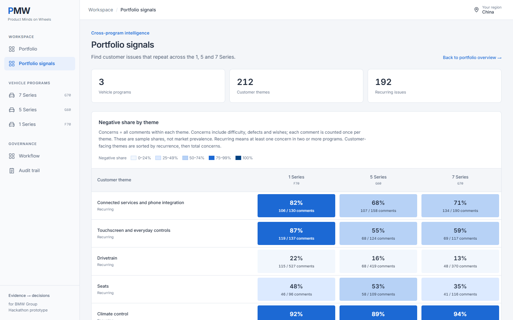
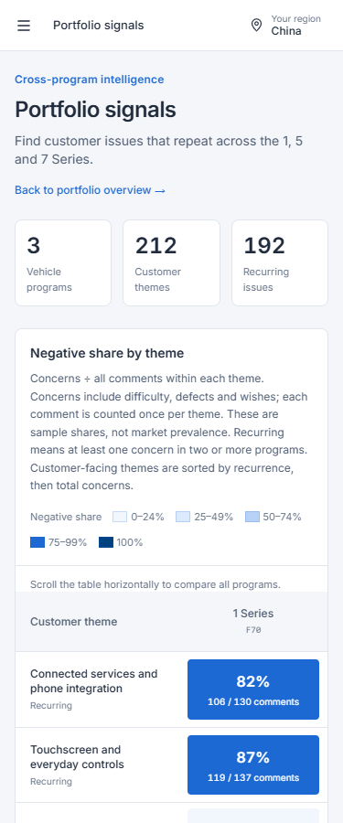
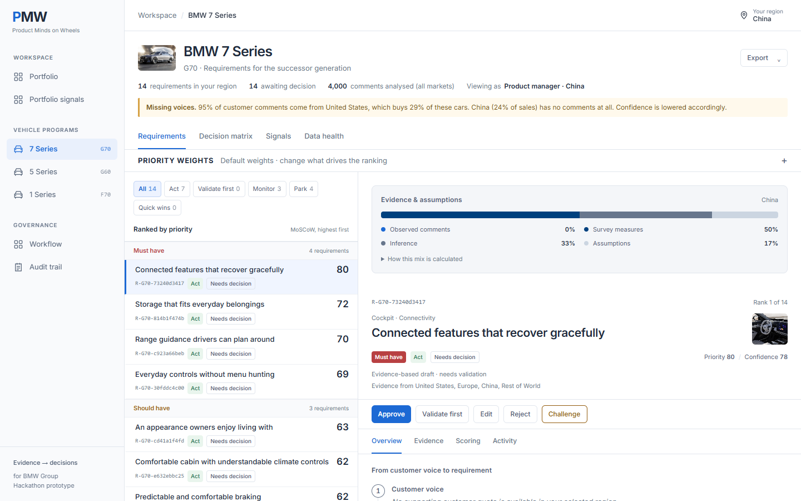
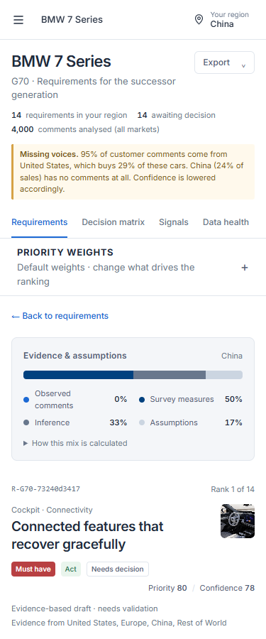

# Phase 2 UI review

Captured from the production build using the isolated, freshly rebuilt dataset. Desktop: 1440 × 900;
mobile: 375 × 900. The viewer is China, so these screenshots contain aggregate evidence without raw US comments.

| Feature | Desktop | Mobile |
|---|---|---|
| Cross-vehicle signals |  |  |
| Evidence and assumptions |  |  |

The China mix has zero observed comments. Browser checks also verify the US version against its stored pipeline
mix, verify all five regions have identical heatmap counts, and exercise horizontal keyboard scrolling and
navigation from every vehicle column. [Delivery notes and migration](../../PHASE2_VISHWA.md).
